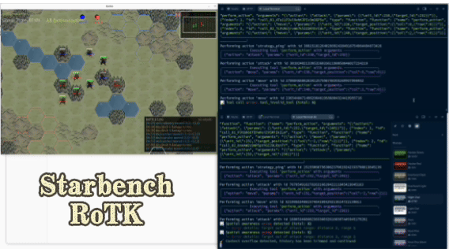
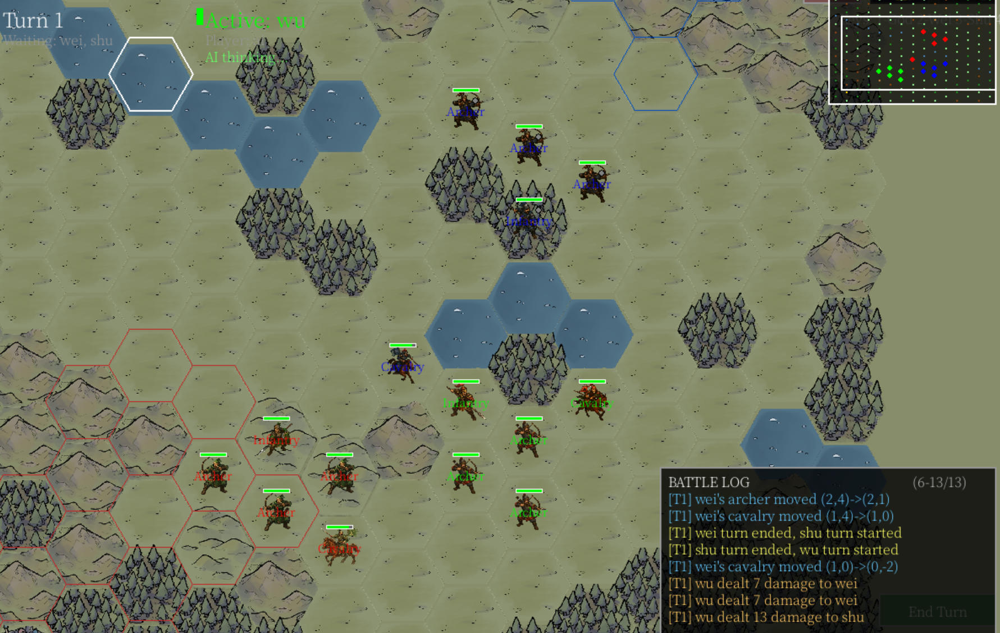
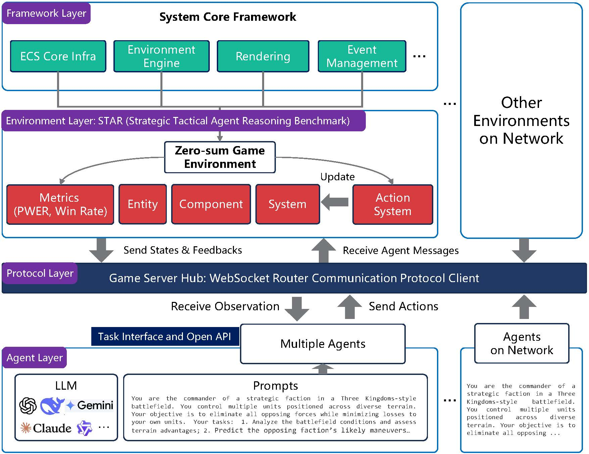

# STAR: Strategic Tactical Agent Reasoning

<div align="center">

[](https://opensource.org/licenses/Apache-2.0)
[](https://www.python.org/)
[]()

[Introduction](#-introduction) • [Quick Start](#-quick-start) • [Game Rules](docs/game-rules.md) • [Usage & Agent Integration](docs/integration.md) • [MCP Arena](docs/arena.md) • [VPS Deployment](deploy/arena/README.md)

</div>

---

<div align="center">
  <a href="https://www.youtube.com/watch?v=4bSB5S3ixLI">
    
  </a>
  <br>
  <a href="https://www.youtube.com/watch?v=4bSB5S3ixLI">
    
  </a>
</div>

## 🚀 Introduction

**STAR (Strategic Tactical Agent Reasoning)** is a modular research framework for studying LLM-driven agents in dynamic multi-agent environments.

STAR focuses on evaluating how large language models perform under **long-horizon strategic planning**, **partial observability**, and **real-time decision constraints**, providing a reproducible interface that integrates simulation, evaluation, and extensible agent interaction.

## Overview

<div align="center">
  
</div>

Recent advances in language models have demonstrated strong reasoning ability in static settings, yet their behavior in interactive, dynamic environments remains less understood. STAR provides a standardized environment for investigating decision-making under uncertainty, adversarial interaction, and execution latency.

The framework is designed to decouple simulation logic, agent reasoning, and communication protocols, enabling researchers to build new environments, integrate diverse agent runtimes, and evaluate strategies within a consistent experimental pipeline.

## Components

STAR is organized around four complementary components:

### 🏆 The Benchmark (`STARBench`)
A benchmarking suite for strategic multi-agent scenarios.
*   **Scenario:** *Romance of the Three Kingdoms (RoTK)* — A zero-sum competitive environment.
*   **Modes:** Configurable real-time and turn-based execution modes.
*   **Metrics:** Standardized evaluation metrics and reporting.

### 🤖 The Agents (`STAR Agents`)
An agent architecture for competitive evaluation in STARBench.
*   **Model-Agnostic:** Supports different LLM backends and provider configurations.
*   **Agent-vs-Agent Evaluation:** Enables LLM agents to compete in standardized STARBench scenarios.
*   **Custom Agent Support:** Researchers plug in via the [Agent–ENV protocol](docs/agent-protocol.md) and `protocol.AgentClient`. `rotk_agent` is a reference LLM client, not the SDK and not the only legal architecture. Board state is [observation + current affordance](docs/observation-affordance.md): ENV is the legality oracle; agents choose among legal actions.

### 🔌 The Protocol (`Star Protocol`)
An asynchronous communication layer for integrating heterogeneous agents and ENVs.
*   **Router Bridge:** Structured message interface between agents and environments
*   **Remote Support:** Runtime-agnostic integration (local or remote)

### 🏗️ The Engine (`STAREngine`)
A modular simulation core built on an Entity–Component–System (ECS) architecture.
*   **Data-Oriented:** Data-oriented design for scalable execution.
*   **LLM-friendly modular design:** The decoupling design enables LLMs to intuitively understand and refactor project mechanics without navigating complex inheritance trees.
*   **Extensible:** Researchers can plug in new environments or swap agent backends (DeepSeek, Qwen, GPT-4) without reinventing the wheel.

---

## System Architecture

STAR adopts a hierarchical, modular architecture designed for scalability.



For gameplay and controls, read the [game rules](docs/game-rules.md).
For desktop/browser setup and Agent connections, use the
[usage and integration guide](docs/integration.md).

| Layer | Component | Description |
| :--- | :--- | :--- |
| **Agent Layer** | *Decision Host* | Decision hosts that speak the [Agent–ENV protocol](docs/agent-protocol.md). |
| **Protocol Layer** | *Nexus Bridge* | Asynchronous protocol and communication abstraction. |
| **Environment Layer** | *Simulation Logic* | Implements specific ENV rules (e.g., RoTK), physics, and vision systems. |
| **Framework Layer** | *STAREngine* | Core ECS-based execution framework. |

The source tree follows these four layers:

```text
framework/   # STAR Engine: reusable ECS and execution primitives
protocol/    # STAR Protocol: communication contracts and SDK
rotk_env/    # STARBench ENV: the Three Kingdoms environment
rotk_agent/  # Reference Agent architecture; participants can supply their own
```

Each layer owns its private implementation. Python and Rust are implementation
choices within the Framework and ENV layers, not additional architectural
layers. Agents connect through STAR Protocol without importing an ENV's
execution kernel or language bindings.

---

## ✨ Key Features

- Strategic multi-agent evaluation
- Real-time and turn-based execution modes. Real-time keeps the world ticking while the model thinks (latency changes outcomes); turn-based is the reproducible bench. The interactive Rust host targets a 60 Hz authority clock; each renderer has an independent display loop.
- Partial observability environments
- Extensible environment and agent integration
- Layered ECS runtime for scalable simulation

---

## 📊 Leaderboard

### 🏆 Rating System: Performance-Weighted Elo (PWER)

Unlike traditional benchmarks that rely on static win rates, STAR introduces an outcome-oriented evaluation system based on the **Performance-Weighted Elo Rating (PWER)**. 

Standard Elo Ratings (SER) treat all victories as equal. However, in long-horizon strategic tasks, the *quality* of the victory matters. PWER improves upon this by introducing a **Performance Multiplier ($M$)** calculated from two objective battle statistics:
1.  **Unit Preservation (Resource Efficiency):** The ratio of surviving units to total initial units. This penalizes strategies that sacrifice units recklessly.
2.  **Time Efficiency:** A normalized measure of how quickly the victory was secured. This rewards decisive planning over prolonged stalemates.

<!-- **Robust Estimation via Bootstrap:** To eliminate the sensitivity of Elo ratings to match order, we employ a Monte Carlo bootstrap approach. We perform 1,000 simulations with randomly shuffled match sequences to compute the **mean rating** and **standard deviation**. This ensures the leaderboard is statistically robust and independent of temporal experiment order. -->

*(For detailed mathematical formulations and qualitative analysis like the "Pyrrhic Victory" effect, please refer to our paper).*

### Turn-Based Mode

| Model | PWER | SER | Win Rate |
| :--- | :--- | :--- | :--- |
| Kimi-K2-Thinking | 1206.1 ± 7.3 | 1149.2 ± 3.7 | 1.000 |
| GLM-4.7 | 1182.7 ± 9.5 | 1122.6 ± 5.2 | 0.857 |
| DeepSeek-Chat | 1166.9 ± 16.8 | 1112.3 ± 9.5 | 0.812 |
| GLM-4.6 | 1098.6 ± 14.2 | 1066.4 ± 7.1 | 0.714 |
| MiniMax-M2.1 | 1078.8 ± 16.4 | 1053.9 ± 7.9 | 0.625 |
| Qwen3-32B | 1006.8 ± 12.0 | 1012.8 ± 6.8 | 0.538 |
| Qwen3-30B-A3B-Thinking | 1005.6 ± 11.4 | 998.5 ± 6.2 | 0.500 |
| GPT-OSS-20B | 988.2 ± 12.1 | 988.0 ± 6.2 | 0.462 |
| Qwen3-14B | 972.7 ± 14.9 | 979.1 ± 8.5 | 0.385 |
| Qwen3-8B | 925.1 ± 9.1 | 952.9 ± 4.3 | 0.300 |
| Qwen3-30B-A3B-Instruct | 877.3 ± 11.8 | 913.9 ± 5.2 | 0.231 |
| Nemotron-Nano-9B-v2 | 865.6 ± 9.5 | 910.9 ± 4.1 | 0.182 |
| Kimi-K2-Instruct | 834.9 ± 13.5 | 880.2 ± 6.5 | 0.143 |
| Qwen3-8B-NoThinking | 790.7 ± 8.2 | 859.3 ± 3.9 | 0.077 |

---

<a id="quick-start"></a>
## 🛠️ Quick Start

**Run your first LLM-vs-LLM match:** start a Hub, launch the battlefield, then
connect one Agent for each faction. You can watch the same Rust-powered game in
**a local Pygame window** or **a Three.js browser view**. Opening the battlefield
alone does not start an LLM Agent.

The steps below run a two-faction, turn-based match: Wei and Shu, controlled by
reference LLM Agents. If you only want to try the controls first, jump to
[the optional offline preview](#optional-try-the-battlefield-without-llm-agents).

### 1. Install STAR

Install [uv](https://docs.astral.sh/uv/getting-started/installation/) and the
[Rust toolchain](https://www.rust-lang.org/tools/install), then open a new terminal:

```bash
git clone https://github.com/star-nexus/star.git
cd star
```

Run STAR commands from this repository root. `uv` manages Python 3.13 and the
project dependencies. The ENV launcher builds Rust on first use, which may take
longer; later launches reuse the build. **For the browser view**, also install
Node/npm and run this once:

```bash
npm ci --prefix rotk_env/rendering/web/client
```

### 2. Configure your model

Create `.configs.toml` in `star` with your model endpoint and API key. This
example uses the reference Agent's DeepSeek profile:

```toml
[deepseek]
model_id = "deepseek-chat"
api_key = "YOUR_API_KEY"
base_url = "https://api.deepseek.com/chat/completions"
max_tokens = 8192
```

Replace `YOUR_API_KEY` with your own key. Both Agents below use this profile;
each makes model calls during play. You can give them different provider
profiles to compare models. For model options, see
[the reference Agent guide](rotk_agent/README.md).

### 3. Start the Hub — Terminal 1

The Hub connects Agents to the battlefield. Clone GameServer alongside `star`
(run these commands from the directory containing `star/`):

```bash
git clone https://github.com/star-nexus/GameServer.git
cd GameServer
uv run fastapi dev gameserver/main.py
```

Keep this terminal running. The following ENV and Agent commands all use
`ws://localhost:8000/ws/metaverse` and match ID `env_1`.

### 4. Start the battlefield — Terminal 2

Open a terminal in `star` and choose **one** of these viewers. Both commands
start the same map, factions, mode and seed, with Rust running the game rules.

**Local window — Pygame (default):**

```bash
uv run starbench.py --skip-start --players ai_vs_ai --mode turn_based \
  --scenario chibi-small --seed 42 --env-id env_1 \
  --hub-url ws://localhost:8000/ws/metaverse
```

The desktop battlefield opens directly, without the configuration menu.

**Browser — Three.js:**

```bash
uv run starbench.py --renderer web --players ai_vs_ai --mode turn_based \
  --scenario chibi-small --seed 42 --env-id env_1 \
  --hub-url ws://localhost:8000/ws/metaverse
```

Open the spectator link printed in the terminal to watch the match. Rust runs
in the server process on your computer; Three.js draws the browser view.
Browser links for AI factions and spectators are read-only.

Keep Terminal 2 running and wait for the Hub connection to be confirmed.
**The battlefield is waiting for its Agents at this point.** An AI slot does
not create a model process automatically. Do not use `--no-hub` for this match:
it prevents external Agents from joining.

### 5. Connect both LLM Agents — Terminals 3 and 4

Open two more terminals in `star`. Start Wei in one:

```bash
uv run rotk_agent/main.py \
  --env-id env_1 --agent-id agent_1 --faction wei \
  --provider deepseek --mode turn_based \
  --hub-url ws://localhost:8000/ws/metaverse
```

Start Shu in the other:

```bash
uv run rotk_agent/main.py \
  --env-id env_1 --agent-id agent_2 --faction shu \
  --provider deepseek --mode turn_based \
  --hub-url ws://localhost:8000/ws/metaverse
```

**You now have an LLM-vs-LLM match.** Confirm that both Agent terminals register
successfully and show model calls/action outcomes; watch the units act and turns
advance in your chosen viewer. Keep all four processes running for the match.

To check the connection without model calls, replace `--provider deepseek` with
`--provider fake` in both Agent commands. `fake` is scripted and is not an LLM
evaluation. Every participant needs a unique `agent_id`; its `env_id`, faction
and mode must match the ENV.

For a human-vs-LLM match, use `--players human_vs_ai` in either ENV command and
start only the Shu Agent; you control Wei. For real-time play, use
`--mode real_time` in ENV and all Agents. See the
[usage and integration guide](docs/integration.md) for other match setups, or
[the Agent–ENV protocol](docs/agent-protocol.md) to connect your own Agent.

### Optional: try the battlefield without LLM Agents

This is a separate offline experience: **no Hub, no model calls, and no automated
opponent in AI slots**. You control human units yourself.

**Local Pygame window:**

```bash
uv run starbench.py --no-hub
```

The configuration menu opens. Choose a map and human player slots, then click
**Start Game**. Use `1` / `2` / `3–5` to select infantry / cavalry / archers,
`M` / `A` to choose a move / attack target, and **F1** for help.

**Three.js browser view** (requires the npm install from step 1):

```bash
uv run starbench.py --renderer web --no-hub --seed 42
```

Open a control link printed by the terminal. This starts two human factions;
use each faction's link to control it, or the spectator link to observe.
Select a unit for movement/attack previews; scroll to zoom, drag to pan and
press **F** to fit the map. Read [game rules and controls](docs/game-rules.md).

Offline previews cannot accept external Agents. To play with LLM Agents,
stop the preview and follow steps 2–5 above.

<details>
<summary>Troubleshooting: the battlefield opens, but Agents do not act</summary>

Check that GameServer, ENV and both Agents are running. They must use the same
Hub URL and `env_id`, distinct Agent IDs, and matching factions and game modes.
For the example above, ENV uses `ai_vs_ai`, and Agents join `wei` and `shu`.
Confirm that neither ENV command includes `--no-hub`; Web needs the explicit
`--hub-url` shown above. If registration succeeds but model calls fail, check
the provider profile and endpoint in `.configs.toml`.

If a local Hub connection fails while a VPN/proxy is active, exclude local
traffic. On macOS/Linux, set this in each ENV/Agent terminal before launching:

```bash
export NO_PROXY="localhost,127.0.0.1,::1" no_proxy="localhost,127.0.0.1,::1"
```

</details>

## Running Agent Evaluation in Batch

If you want to evaluate agents in batch, you can run the headless evaluation mode:

First, give the competitors in the `provider.txt` like:

```bash
deepseek,glm_47
glm_46,deepseek
```

Then, start the script to launch the evaluation in batch. It defaults to Rust ENV
(native1, threaded authority), prepares ENV dependencies automatically, and waits for both world
initialization and Hub confirmation before launching Agents. Use `--backend python`
for the reference path; `--native-threads 1|2|4` and
`--native-scheduling threaded|serial` are forwarded to each ENV.
Each match writes its backend/source/extension identity to `logs/run_<pid>/match_<n>_runtime.json`.
```bash
uv run python auto_test.py --mode real_time --players ai_vs_ai --report-wait 120 --list provider.txt

```

---

## 🗺️ Roadmap

### Core Infrastructure
- [x] ECS-based simulation runtime with scene and entity lifecycle management
- [x] Event-driven execution model and message abstraction
- [x] Deterministic scheduling for reproducible experiments

### Communication Layer
- [x] Bidirectional agent–environment interface via structured message envelopes
- [x] Decoupled hub-based routing between agents and environments
- [x] Support for distributed and remote execution

### STARBench (RoTK Scenario)
- [x] Hex-grid zero-sum strategy environment
- [x] Partial observability (fog-of-war) mechanics
- [x] Turn-based and real-time execution modes
- [x] LLM-driven control interface and standardized observation API

### Agent Framework
- [x] LLM-based decision agents with tool-to-action mapping
- [x] Multi-provider backend support
- [x] Fully decoupled from environment runtime via protocol abstraction
- [x] Minimal agent–ENV protocol spec for custom architectures (`docs/agent-protocol.md`)
- [x] Observation + Affordance contract for `get_faction_state` (`docs/observation-affordance.md`)

## Citation

If you find this project useful in your research, please consider citing:

```bibtex

@misc{li2026scalingassessingstrategicreasoning,
      title={Beyond Scaling: Assessing Strategic Reasoning and Rapid Decision-Making Capability of LLMs in Zero-sum Environments}, 
      author={Yang Li and Xing Chen and Yutao Liu and Gege Qi and Yanxian BI and Zizhe Wang and Yunjian Zhang and Yao Zhu},
      year={2026},
      eprint={2603.09337},
      archivePrefix={arXiv},
      primaryClass={cs.CV},
      url={https://arxiv.org/abs/2603.09337}, 
}
```

## Playing STARBench

Select a human-controlled unit to preview movement and attack range. Space and
End Turn finish the current human turn. Read the [game rules and controls](docs/game-rules.md)
for terrain, resources, fog and victory conditions; see the [usage guide](docs/integration.md)
to start desktop/browser play or connect Agents.
