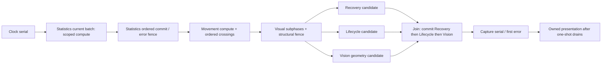

# E1: ECS System parallelism design exploration

2026-09-30. User steered the next task to **between-System and within-System
parallelism**. P0's encoded cross-request batch candidate is deferred; it remains
in its immutable evidence package. This design uses c058d75c0ad67a7c340c2a6ac74a9d5bc2888adf,
P0 measurement2ac2b29 and locked Bevy0.19.1. Target5000 Units/1000 Agents;
5000 Agents paused. Rust executes authority; Python preserves interface/ecosystem.

Progress: `access audit █ | locked-API probes █ | design alternatives █ | production prototype ░ | capacity ░`.
Exploration is complete; no production world System is parallelized by E1.
E2 now implements the selected Statistics leaf with a128-row cutoff;
see [implementation, measured controls and gate status](native-statistics-parallel.md).
This document preserves the E1 design decision and subsequent roadmap.

## 1. What currently prevents scheduling

`Runtime::step_inner` calls sequential methods with `&mut Runtime`; wrapping each
method as an exclusive `&mut World` System, or storing Runtime behind one mutable
Resource/mutex, still serializes them. Bevy cannot distinguish keys of the current
singletons BTreeMap or fields of one mutable Resource. Broad access is an interface
constraint, distinct from a real rule dependency. Narrow Query/Res declarations
must include indexes, timers, cold data, events, dirty sets and structural writes.

[Full baseline access/cost audit](native-system-dependencies.md) remains the starting
point. External calls still acquire the instance mutex after GIL release; parallel
work remains inside that admission boundary and joins before step/reset/close.

## 2. Between-System candidate matrix

“Candidate” means source-level access and ordering support further refactoring,
not that the existing methods are thread-safe or production-equivalent tests passed.

| Pair / region | Semantic access assessment | Boundary required | Current priority |
|---|---|---|---|
| Recovery ∥ Lifecycle | Recovery writes AP/MP/SP/deadlines/Unit dirty; Lifecycle reads clock/liveness/mode and writes GameState/GameOver event. No rule data edge found in current step paths | After Statistics/Visuals succeed; stable entity registry; split recovery resources from GameState/events | Feasible narrow-access candidate; tiny cost |
| Recovery ∥ Vision | Recovery uses AP/MP/SP and deadlines; Vision uses Position/UnitInfo/Vision/terrain/Fog/cache. Both read the same stable registry; different components/resources | After Movement/Visuals; no spawn/despawn while queries run; separate Unit/Fog dirty outputs; preserve deadline/LRU commits | Strongest whole-region candidate structurally; insufficient current-load savings |
| Lifecycle ∥ Vision | GameState/liveness/clock vs Vision/Fog/cache are disjoint. Vision does not read game_over and the original step does not stop after Lifecycle sets it | Keep GameOver event position in event sequence, join before Capture/presentation; do not add a game_over early stop | Feasible narrow-access candidate; tiny lifecycle cost |
| Recovery ∥ Lifecycle ∥ Vision | Above three may overlap computation after Visuals, then merge outputs in Recovery→Lifecycle→Vision order | Original success/error fences and structural boundaries, split typed access, ordered side-effect commits | First between-System prototype group if this route is pursued |
| Statistics ∥ Movement | Statistics samples Position before Movement; movement changes Position and occupancy | Only pre-movement typed sample/candidate calculation can overlap on a stable read cut; Statistics commits/errors gate Movement commit | Never parallelize complete current methods |
| Statistics ∥ Recovery | Statistics observations read old MovePoints (current_mp/has_moved); Recovery changes them | Capture only currently scheduled statistics rows before recovery; commit Statistics first, stop on its first error | Conditional compute-only overlap; no whole-method concurrency |
| Statistics ∥ Vision | Visibility sampling reads prior Fog; Vision changes it; UnitObservation may be structurally inserted | Old-Fog sampling must finish or own an exact narrow input before Vision writes; no entire-world snapshot | Keep full phase order; pure candidates only |
| Movement ∥ Vision / Capture | Position/spatial/vision_dirty and capture cancellation/read-position edges | Movement commits before either consumer; hypothetical geometry plans must use exact resulting positions | Sequential rule dependency |
| Visuals ∥ other World consumers | Visuals can allocate/remove entities; imported entities can combine Unit and visual components. Recovery also audits next_id | Preserve attack→projectile→effect→text, structural fence, exact new-ID/deletion visibility | Do not assume all visual entities are disjoint from Units |
| Capture/Combat/Turn ∥ world writers | Shared targets, owner/state/resources, structural mutations, immediate death, event order and RNG | Keep accepted action order, existing immediate writes and tick placement | Outside first parallel region |

P0 per-tick samples give an ideal zero-overhead ceiling for the independent
Recovery/Lifecycle/Vision region: `sum(durations)-max(durations)` averages3.883µs
(P9913.292µs) across9880 ticks. This uses paired headless P0 times, not a new live
A/B. It includes all original phase work as if fully parallelizable and ignores
packing, scheduler and ordered-commit cost, so it is optimistic. Existing scoped
empty-job dispatch median was9.125µs at2 workers and7.084µs at4, in a separate
1000-sample mechanism diagnostic. These are not a causal same-workload comparison,
but give no justification for a default scheduler change at the current load.

## 3. Within-System candidate matrix

| System | Parallel leaf / input | Sequential work that must remain | Pitfalls / priority |
|---|---|---|---|
| Statistics observations | Current cycle batch only: typed UnitInfo/Headcount/Position/MovePoints plus prior UnitObservation, terrain and timestamp → owned candidate/record per original ordinal | Global time update; creation of missing UnitObservation; per-ID patch/history append and exact trim; cycle state; first-error prefix | P0 largest mean0.167ms; first implementation candidate, but compute-vs-commit cost still unknown |
| Statistics visibility | Current phase batch reads prior Fog and previous visible set → per-ID visible factions/newly/lost candidate | Tracker clear at original moment; faction membership/history/visibility_limit and UnitObservation writes in ordinal order | Keep observation→visibility→factions on separate original ticks; not all phases in one tick |
| Statistics factions | Per-row living faction contribution | Preserve first-appearance initialization and existing integer/JSON insertion order; final reductions/cycle completion | Small leaf; do not change non-associative floating reductions or insertion order |
| Movement | Active IDs only; per-unit dt/path arithmetic on typed inputs → ordered crossings and final Movement patch | Apply EVERY original path crossing to spatial index; vision/Unit dirty; cleanup active IDs in external-ID order | Mean0.027ms; good dependency example, lower current-cost priority; no path/occupancy rule change |
| Vision | Uncached pure terrain LOS geometry for dirty IDs → immutable HexSet | Audit/dirty selection; simulate cache key/hit/stamp/LRU/eviction in original order; Fog refcounts/explored/delta and Vision patches ordered | Mean0.045ms; second internal candidate if misses dominate; never equate distinct Units with independent Fog writes |
| Recovery | Independent AP/MP/SP arithmetic for already-selected current versioned due entries | New-ID audit; MP pending next-boundary handling; due/version validation; schedule/cancel/ledger writes and dirty merge | Mean0.0036ms; duplicate/stale tasks need sequential selection; low priority |
| Visuals | Each current animation phase's row arithmetic | Exact subphase commits/spawns/removals; new projectile receives full current dt; partial effect-error behavior | Mean0.010ms; structural/output ordering dominates safety work |
| Capture | Per-capture candidate/progress after Movement | Shared tile winner/cancellation/owner/World removal and first-error prefix in active ID order | Mean0.000072ms in canonical P0; almost no workload evidence |
| Lifecycle | Scalar timeout/annihilation decision | State/event commit; annihilation before timeout | Too small to split internally |
| Observation | Existing stable per-Unit panels already parallelize | Faction projection/authorization and ordered caller cache merge | Reuse existing mechanism; cross-request sharing stays a distinct deferred task |

The actual R4e Statistics config is window/indexed, batch_size128,
observation_interval1s, history_limit10000, visibility_limit1. A5000-Unit scene is
NOT a5000-row statistics batch every tick. Never replace the current chunked cycle
with a full scan to create a parallel workload. Preserve O(active/due/current batch).

### Failure and cache counterexamples

- `StatisticsSystem::observations`: a max_count0 row errors before that row's writes;
  preceding rows and global time writes remain. Parallel prevalidation with full
  rollback changes behavior. Return `Result<RowCandidate>` by original ordinal,
  commit the exact successful prefix, then raise the same first error. Preserve
  existing cycle.take/restore behavior, including its failure state.
- Missing UnitObservation causes immediate component insertion. Keep this in serial
  commit; `.par_iter_mut` cannot safely reproduce structural insertion in workers.
- Vision capacity1 with key stream A,B,A has eviction-dependent miss/hit/LRU/export
  behavior. Naive batch cache lookup/dedup changes diagnostics/state. Plan the exact
  serial metadata sequence before geometry jobs; pure geometry reuse may reduce
  computation only while replaying every original lookup/counter/eviction.
- Never let worker completion decide history/event order, spatial conflicts or RNG
  consumption. A result buffer keyed by original external-ID/ordinal is required.
- Bevy `.after()` means a dependency completed, not that it succeeded. Stock System
  error handling/deferred commands is not Runtime::step's early-return contract.
  Fallible commits need explicit phase outcomes/abort gates; later writes cannot
  occur after an earlier failure. Errors do not trigger action retry.

## 4. Architecture alternatives

| Route | Representation/execution | Advantage | Required work / decision |
|---|---|---|---|
| A: native Bevy Schedule | Persistent Schedule; typed component Query and separate clock/registry/activity/recovery/Fog/cache/state resources; explicit before/after and structural fences | Declared compatible System accesses can overlap; ECS query storage stays native | Current broad Runtime/World APIs and monolithic singletons need real decomposition; error abort gates; global pool ownership; prototype after leaf extraction |
| B: scoped compute + ordered commit | Keep Runtime/OrderedWorld owner; extract narrow pure kernels, dispatch bounded chunks to existing ReadPool, return owned candidates, commit in original order | Small migration boundary, existing per-instance1/2/4 lifecycle and no second authority | Measure gather/clone/output/commit separately; no full-world snapshot; recommended first route for Statistics |
| C: Bevy active-subset parallel queries | par_iter_many_unique_mut(EntitySet) on unique active handles with side effects buffered | Avoid a new full resident query for sparse work; actual locked API compiled/probed | Order/thread assignment not promised; caller may execute jobs; structural mutation forbidden; dirty membership still must be maintained |
| D: per-System threads/mutex Runtime | Give workers whole Runtime through locks | Minimal wrapper | Serializes writes or violates state order; reject |
| E: whole-world snapshot/delayed frame-end commands | Copy world then independent tasks or defer all mutations | Easy superficial task separation | Repeats known copy costs or changes immediate gameplay; reject |

Recommended compute/commit model (a design, not current execution):

Do not implement every box simultaneously. Whole-region typed concurrent mutation
is an alternative to candidate buffers only after disjoint access and exact side
effects/error contracts are demonstrated. The diagram retains explicit commits.

### Worker budget and lifecycle

Existing ReadPool owns an instance-specific pool, uses
scope_with_executor(false,None), joins before returning and does not run jobs on
the caller. Locked Bevy Schedule uses a process-global ComputeTaskPool; active
parallel Query uses its scope, whose caller can participate. Global first
initialization and process-wide lifetime cannot silently replace the public
per-instance threads=1/2/4 contract. Probe modes run in separate processes and do
not prove a production worker budget. Pick one pool owner before combined use;
do not initialize an automatic global pool alongside each observation pool or
nest blocking jobs on another pool. Mixed-instance/reset/close tests are required.

`Changed<T>` is not an O(active) substitute. Unique active handles must come from
existing maintained indexes, preserve missing-ID behavior and avoid duplicate
mutable entity references. Schedule/SystemState/query caches are tied to their
World; reset to replacement World rebuilds them once and retains failure atomicity.

## 5. Locked API and mechanism evidence

E1 Lab harness links actual star-core/rotk types and Bevy0.19.1; resolved package
versions match the source Cargo.lock. At1/2/4, disjoint MovePoints/Vision sample
Systems have maximum simultaneous bodies1/2/2; shared component/resource/exclusive
cases remain1. The active query changes exactly100 selected of5000 resident
entities. Existing ReadPool returns5000 owned outputs in input order at2/4.
This proves scheduler/access/subset mechanisms, NOT actual Recovery/Vision rules,
whole-world determinism, speedup or a capacity frontier.

Use0.19.1 `Schedule::set_executor(MultiThreadedExecutor::new())` and
`bevy_ecs::batching::BatchingStrategy`. Initial probe used older API paths and
failed compilation before workload; corrected against locked source. That setup
failure is not a gameplay GAP and is excluded from formal workload evidence.

## 6. Selected first production prototype and gates

E2 should extract **Statistics current-batch compute + ordered commit** with
threads1 first. Subdivide observations/visibility/factions and time gather,
computation, JSON row construction, ordered writes/trim and scheduling. Its
0.167ms mean includes all these and is not proven parallelizable time.

1. Serial split must match c058d75 complete responses, every full presentation,
   authoritative state and first-error/partial-write states; no new algorithm,
   chunk size, history retention or sampling cadence.
2. Only the measured independent portion then uses existing2/4 workers. Split
   the same currently scheduled128-row batch; owned results indexed by original
   ordinal. Empty/tiny work runs inline; crossover threshold comes from evidence.
3. Include none/dummy/window, modes, sparse/dense/disabled phases, zero-count error
   in first/middle/last row, missing observation insertion, cycle completion,
   Fog on/off/old-current boundary, reset/close and worker failure. Preserve all
   typed/cold/resource/index/event/RNG and response fields, not just final hash.
4. Replay recorded R4e input at1/2/4, then genuine same-profile5000/1000 window
   tests. Separate high-active/high-dirty inputs as synthetic negative controls;
   they must not replace canonical capacity or restore5000-Agent tuning.
5. Keep single-thread path as baseline; choose defaults only from net whole-call
   and frame/queue evidence. Retain slower cases. No approximate Fog, rule changes,
   RNG rescheduling, reduced observations or frame-end action commits.

Between-System Recovery/Lifecycle/Vision remains a documented feasible refactor
route and can be prototyped for dependency validation separately; present costs
make it a lower throughput priority. Statistics/Movement compute-only overlap is
an advanced stage after serial leaf decomposition, not a premise of E2.

G001–G003 baseline changes and G008/G009/R001/R002 stay open/preserved as before.
E1 is a design/mechanism checkpoint; default Python/native1thread unchanged.
Lab recovery: `/Users/liyang/Developer/star-lab/records/rust-ecs-parallel.md`;
formal package: `2026-09-rust-ecs-parallel-design`.
