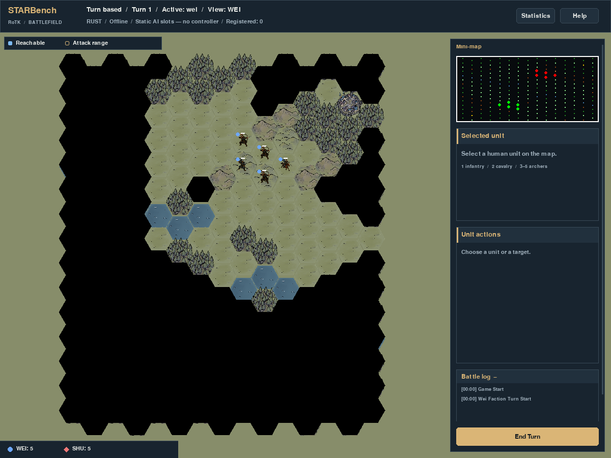

# 多渲染器验收问题修复

2026-10-11，在 `codex/render-adapters` 修复[首次验收](../render-adapters-acceptance/README.md)确认的 P1、P2。**两项缺陷已修复，当前在线多渲染器范围内的验收通过。** 原始失败记录保留，本目录保存修复后的证据。

## P1：展示实体与权威初始化分离

`prepare_display_world()` 先建立纯规则场景、生成 native 初始化数据；即使选择桌面 window，也不在此阶段导入 pygame 或初始化相机/按钮。interactive 优化策略继续保留。Rust 接收初始化数据并发布展示基线之后，pygame 适配器才挂载输入、相机、动作面板、工具栏和 HUD。

ECS 提供独立的本地辅助实体分配器；桌面工具栏使用 -1 至 -4，native 实体和原生动画保持非负 ID。后续 native 创建实体不会覆盖工具栏，UI 的增删也不消耗权威分配计数。初始化导出排除本地展示实体及 `UIButton`，若本地实体夹带权威组件则直接报错。

同 seed=42、chibi-small、两个 human 槽位、interactive 策略，在回合制9个、即时制7个检查点中，none、pygame、web 的**完整权威状态与 Agent 响应均完全一致**；绘制也不修改权威状态。移动、待命、受控 dt、回合切换、Agent 注册、状态查询、错误响应均在对照范围内，见 [rules-comparison.json](rules-comparison.json)。

| chibi-small 初始化 | 修复前 pygame | 修复后 none / pygame / web |
| --- | --- | --- |
| native `entity_counter` | 241 | 237 |
| 魏步兵 `unit_id` | 231 | 227 |
| native 中的 `UIButton` | 4 | 0 |

**兼容记录：** 新桌面对局中的玩家/单位 ID 会与旧桌面记录不同，客户端应读取当前对局返回的 ID，不能复用旧录制或硬编码 ID。协议字段、动作、权限及 SDK 接入方式保留。none/Web 与修复前的全部对照状态、Agent 响应哈希一致，见 [identity-compatibility.json](identity-compatibility.json)。这项修复统一桌面初始化，而不改变已有 Web/无显示规则行为。

## P2：PNG 标签与实际字节一致

`capture_rendered_frame()` 使用显式 `frame.png` 编码提示，实际返回 PNG，不再产生带 `png` 标签的 TGA。原有截图围栏、全局画面视角、错误字段、授权检查和只读绘制保留。Python/native VLM 对照继续覆盖两种模式、三种 display 配置与1/2/4个 native worker，并检查 PNG 签名、解码尺寸和 RGB 像素。

pygame 视觉版本更新为 **`starbench-ui-v7`**，用于区分这次图像观测编码变化。Web 保持 **`starbench-web-v4`**。PNG 解码后的 1200×900 Rust 固定启动画面与首次验收保存的 ui-v6 PNG 逐像素一致，见 [capture-validation.json](capture-validation.json)。原始图像观测字节由 TGA 改为 PNG；历史图像 benchmark 应保留旧版本标记，依赖 TGA 解码的外部消费端需按 `frame_format` 改用 PNG。



## 验证与边界

| 检查 | 结果 |
| --- | --- |
| framework / protocol / ENV / Agent 完整 Python 回归 | 2795 passed，0 skipped |
| Web 客户端测试 | 17 passed，0 skipped |
| 未安装 pygame 环境：Web、范围、边界、适配器测试 | 24 passed，0 skipped |
| 最终测试文件组织后的会话/适配器补充回归 | 33 passed，0 skipped |
| Web HTTP/WebSocket、Hub、结束回合 AP 恢复，无 pygame 导入 | [通过](web-dependencies.json) |
| pygame 绘制/截图，拒绝 Web 模块导入 | [通过](pygame-dependencies.json) |
| Rust 源码/二进制、protocol、Agent 源码相对集成基线 | 无变化；API18/schema5 保留 |

门禁增加了本地 ID 与未来 native ID 的碰撞检查、两地图/两模式的三适配器初始化与 Agent 观测对照、window 权威准备阶段拒绝引擎导入，以及本地展示实体夹带规则组件时的拒绝检查。原有 End Turn 与 Space 资源恢复/事件对照继续通过。

Web Agent 图像观测、离线 WASM、菜单/回放功能及大规模 Web 容量基准仍按原报告归入后续能力。本轮没有新的容量或 GPU 性能结论。`main` 和 `codex/rust-ecs-parallel` 分支引用保持原值；修复仅提交到 renderer 分支。

复跑主要证据：

```bash
SDL_VIDEODRIVER=dummy SDL_AUDIODRIVER=dummy .venv/bin/python -m pytest -q framework/tests protocol/tests rotk_env/tests rotk_agent/tests
npm test --prefix rotk_env/rendering/web/client
PYTHONPATH=. .venv/bin/python docs/render-adapters-acceptance/check_rules.py --output /tmp/star-render-fixes-rules.json
PYTHONPATH=. .venv/bin/python docs/render-adapters-fixes/check_capture.py --output /tmp/star-render-fixes-capture
```

[validation.json](validation.json) 记录具体命令、结果、源文件/证据哈希及 native 二进制哈希。
