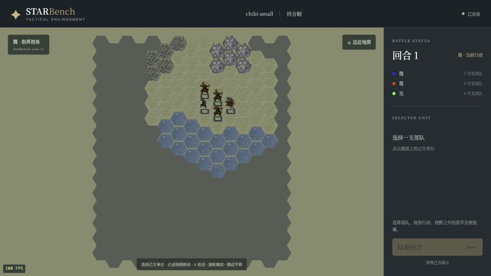

# Web v3：默认 FPS 与渲染依赖边界

2026-10-11，分支 `codex/render-adapters`，改动前提交 `e2f01f1`。

地图默认显示小型绿色 FPS 角标：桌面左下角，窄屏右上侧，每秒根据完成的浏览器绘制帧更新。角标不接收点击，切换页面可见性后重新计数；显示帧率不等于 Rust 60Hz 时钟或最多 20Hz 的状态包频率。详细诊断仍由 `?perf=1` 开启，默认路径不进行 CPU/p95/运动轨迹采样。v2 的插值、实例批次与 DOM 复用保持。



[390×844 窄屏截图](web-fps-mobile.jpg)及 [DOM 布局证据](browser-mobile.json)确认角标不覆盖适应地图按钮。浏览器默认画面证据见 [browser-default.json](browser-default.json)，额外诊断见 [browser-diagnostics.json](browser-diagnostics.json)。截图中的 FPS 是当前检查窗口的观测值，不能代表其他机器或大规模对局性能。实际浏览器检查还点击了结束回合按钮，返回“指令已执行”，当前行动阵营切到蜀，角标未阻挡输入。

本次补查并移除了以下残留耦合：

- `RustRuntime`、`AuthorityRuntime`、Python 动作处理器在缺失截图回调时默认导入 pygame。改为通用可选能力，具体截图实现由宿主显式提供；未配置时保留成功的结构化观测及无图像错误字段。
- 菜单组件里的字体测量与 `pygame.Rect` 移到 `ui/start_layout.py`。
- `GameConfig` 不再读取 pygame 窗口，只接收尺寸；读取窗口的实现放在 `rendering/pygame/display.py`。
- 通用快捷键数据使用引擎无关的键名；pygame 键码和修饰键解码放在 `rendering/pygame/controls.py`。
- runtime 身份的视觉版本由宿主传入，不从底层导入 UI。

pygame 会话使用独立 `PygameFrameProvider`，历史桌面 headless 入口也显式安装该能力。桌面像素与 Agent 观测字节保持一致。Web 仍没有 Agent 图像提供器，不因 VLM 请求导入 pygame。

`test_renderer_boundaries.py` 静态检查组件、配置、规则、ECS、协议与权威 runtime 的直接、间接、函数内导入，并检查 Rust 依赖锁。场景/会话的组装入口和历史展示系统单独界定；none/Web 分支通过新进程禁止图形导入检查。未来增加的规则模块默认受保护，新的渲染实现应放在 `rendering/`。

验证结果记录在 [validation.json](validation.json)：

- 完整 Python 测试：2781 passed，147.13 秒；前端：13 passed，包括 30/60/144Hz 计数、后台切换与默认角标。
- 无 pygame 的独立环境：边界和动作目录测试 22 passed；[Web 探针](web-dependencies.json)覆盖 HTTP/WebSocket、结束回合恢复 AP、原有 Hub 接入、VLM 无回退和关闭。[桌面探针](pygame-dependencies.json)反向阻止 Web 导入。
- [桌面对照](desktop-parity.json)：与 Rust 集成提交 `2598697` 的 RGB 和观测字节 SHA256 相同，Web/桌面初始规则与 Fog 一致。
- Rust 源码、依赖锁、star-protocol 和原生二进制保持；API18/schema5、render schema1、默认 worker=1 不变。本次不重跑大规模 native 性能实验，也不据此声称新的容量结论。

Web 视觉版本升为 `starbench-web-v3`，pygame 保持 `starbench-ui-v6`。重启 Web 服务后使用新链接并刷新网页即可显示角标。

复跑命令：

```bash
.venv/bin/python -m pytest -q framework/tests protocol/tests rotk_env/tests rotk_agent/tests
npm test --prefix rotk_env/rendering/web/client
PYTHONPATH=. .venv/bin/python docs/render-adapters-v1/check_desktop.py --output docs/render-adapters-v3
.venv/bin/python -m rotk_env.tests.renderer_dependency_probe pygame
# 在只安装 native extra、没有 pygame 的项目环境中：
python -m pytest -q rotk_env/tests/test_renderer_boundaries.py rotk_env/tests/test_action_catalog.py
python -m rotk_env.tests.renderer_dependency_probe web
```
