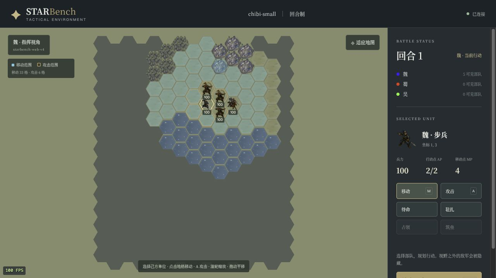

# Web v4：选中单位的范围高亮

2026-10-11，在 `codex/render-adapters` 从 `d2a7e21` 继续实现。

此前 Web 只绘制选中圈，没有接入桌面已有的移动和攻击范围效果。本次增加蓝色移动填充、橙色攻击轮廓、范围内可见敌军的红色目标圈；切换 `M/A` 或按钮会调整范围强调。按 `Esc`、单位消失、断线或对局结束会清除叠层。



[攻击模式截图](attack-range.jpg)与[窄屏截图](mobile-range.jpg)记录对应画面。实际浏览器点击魏步兵后显示“移动33格 / 攻击6格”，切换攻击模式、按 Esc、快捷键选中均验证；默认 FPS 继续可见。截图中的100 FPS 是该检查窗口的观测值，不是大规模容量结论。图例不占用侧栏空间，不拦截地图点击。

范围规则属于 ENV 数据查询，颜色、填充和线条属于渲染适配器。新增 `rendering/tactics.py` 复用无引擎依赖的 MP 预算、加权寻路与 hex 范围查询；服务端发出纯坐标/ID，Three.js 的 `ranges.js` 使用实例批次绘制。内核、star-protocol、Agent SDK 和 pygame 路径没有新增图形依赖。

范围是连接本地的展示状态：两个魏浏览器的选择互不影响，旁观者可选择全部单位，阵营视角只提供己方范围。请求不会注册 Agent、改变 AP/MP、推进时钟或改动权威世界。范围仅基于已知地形及视角可见单位，不读取隐藏敌军的占用或私人资源；未知阻挡和实际指令执行仍由 Rust 判定。攻击轮廓表示几何范围，AP 等资源是否允许攻击由原有执行入口校验。

只为选中单位计算范围，缓存最多32项；MP、兵力、移动中状态、逻辑位置、地格和可见占用变更会刷新提示。客户端不计算游戏规则，相同范围的100次刷新保持网格及 GPU 缓冲，红圈跟随已有插值位置。新增边界检查保护 `projection.py / tactics.py / commands.py`，防止展示语义模型依赖具体引擎。

验收证据见 [validation.json](validation.json)、[浏览器选中结果](browser-selection.json)、[取消选择结果](browser-clear.json)及[窄屏布局](browser-mobile.json)。无 pygame 环境同时运行选中范围与 HTTP/WebSocket 测试；[Web 探针](web-dependencies.json)验证原有 Hub、结束回合 AP 恢复和 VLM 无回退，[pygame 探针](pygame-dependencies.json)验证反向隔离及截图能力。桌面沿用 [v3 像素及观测字节对照](../render-adapters-v3/desktop-parity.json)。

本次相关 Python 测试71项通过，前端测试17项通过；未安装 pygame 的环境下，范围、Web 宿主和架构边界测试16项通过。静态导入检查、双向依赖探针均通过。上述检查为本次范围改动的验证，不替代 v3 中已经记录的全套测试或 native 性能基线。

Web 视觉版本记录为 `starbench-web-v4`，pygame 保持 `starbench-ui-v6`；native API18/schema5、展示 schema1 保持。Rust 源码、二进制、默认 worker=1 和 Agent 接入保持。本次不重跑大规模 native 性能实验。

复跑主要检查：

```bash
npm test --prefix rotk_env/rendering/web/client
.venv/bin/python -m pytest -q rotk_env/tests/test_render_tactics.py rotk_env/tests/test_web_server.py \
  rotk_env/tests/test_render_projection.py rotk_env/tests/test_web_commands.py \
  rotk_env/tests/test_renderer_dependencies.py rotk_env/tests/test_renderer_adapters.py \
  rotk_env/tests/test_renderer_boundaries.py rotk_env/tests/test_move_rules.py \
  rotk_env/tests/test_hex_in_range_translation.py
# 以下可以在未安装 pygame 的 native 环境中执行：
python -m pytest -q rotk_env/tests/test_render_tactics.py rotk_env/tests/test_web_server.py rotk_env/tests/test_renderer_boundaries.py
```

重启服务后使用新链接并刷新网页，使 Python 宿主与前端同时升级。
