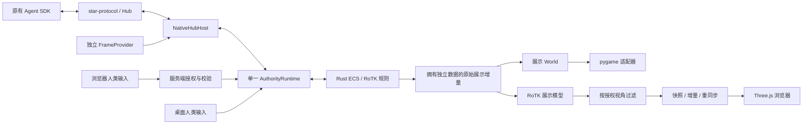

# 多渲染器接入：第一版

2026-10-11，在 `codex/render-adapters` 实现。沿用[已确认的顶层设计](architecture/renderers/proposed.html)：服务端 Rust 执行权威规则，pygame / Three.js 读取展示投影。浏览器不运行 Rust/WASM。

## 启动

从仓库根目录执行，首次安装 Web 素材依赖需要 Node/npm：

```bash
npm ci --prefix rotk_env/rendering/web/client
uv run starbench.py --renderer web --no-hub --scenario chibi-small --seed 42
```

打开终端打印的魏、蜀或旁观链接。默认两个人类槽位，分别使用对应链接，两个页面共享同一 Rust 对局。链接中的凭据绑定服务端视角，每次启动重新生成，使用 URL fragment 而不进入 HTTP 请求路径。普通启动仍为 pygame：`uv run starbench.py --no-hub`。

Web 的 Hub 接入使用原来的宿主与 SDK：

```bash
uv run starbench.py --renderer web --players human_vs_ai --hub-url ws://localhost:8000/ws/metaverse --env-id env_1
uv run starbench.py --renderer web --players three_kingdoms --mode real_time --hub-url ws://localhost:8000/ws/metaverse --env-id env_1
```

Agent 继续通过原来的 Hub 注册、认领单位、提交动作及读取观测；AI 槽位的浏览器链接只读。Web 默认离线；显式 `--hub-url` 或 `STAR_HUB_URL` 接入，`--no-hub` 优先。没有自动 BOT。Web 参数与桌面参数分别由各自入口校验；Web 不支持 `--headless`、`--mock-ai`、`--native-scheduling serial` 等桌面选项。

浏览器操作：点击己方部队选择，再点击地格移动；`M/A` 切换移动/攻击目标，按钮提供待命、驻扎、占领和筑垒；`1` 步兵、`2` 骑兵、`3/4/5` 弓兵；`Space` 与“结束回合”按钮共用同一个命令函数。滚轮缩放、拖动平移、`F` 适应地图，窗口调整后重新计算正交相机范围。

## 目录与职责

四个产品层的顶层目录保持原样。RoTK 专属数据和 Web 服务都在 ENV 内，没有新建顶层前端项目。

```text
framework/presentation/
  contracts.py                 RendererAdapter / FrameProvider 通用契约
  stream.py                    可丢弃展示状态的一槽邮箱
rotk_env/rendering/
  __init__.py                  注册与延迟加载适配器
  adapters.py                  none / web 适配器与默认截图能力
  pygame_adapter.py            原桌面渲染、输入与 UI 挂载
  projection.py                RoTK 展示模型、视野过滤与视角增量
  commands.py                  服务端视角授权与人类命令校验
  web/
    __main__.py                Web 对局入口
    server.py                  HTTP 素材与 WebSocket 展示宿主
    client/                    Three.js、HTML/CSS、显示状态、npm 锁文件
      tests/                   浏览器状态与坐标单元测试
rotk_env/runtime/              原有 Rust/PyO3 宿主、权威调度、Hub、生命周期
rotk_env/prefabs/              场景初始化及模拟策略选择
rotk_env/systems/              原有系统与性能路径
rotk_env/components/           原有组件
rotk_env/maps/                 原有地图
docs/render-adapters-v1/       验证记录、视觉版本、截图、桌面对照脚本
```

`node_modules` 和 `.archify` 作者工具中间文件忽略；固定设计图保存在 `docs/architecture/renderers/`。



图中的 pygame 与 Web 是可选宿主配置；每个 `NativeSession` 安装一个展示适配器。Web 宿主可以给多个浏览器分发不同视角，它们共享一个权威世界。原始 native 增量和未过滤事件不直接发给浏览器。

## 规则、性能路径与截图边界

`simulation_profile` 从实际绘制模式中分离。默认桌面仍使用原有 interactive 路径，原有 none/dummy/headless 默认保持参考路径。Web 无 SDL 窗口，但选择 interactive：复用空间索引、窗口版本 Vision / Movement / Combat / ResourceRecovery / Statistics / Realtime 的初始化，以及权威移动与视觉生命周期。

API18/schema5 内部的历史 `display="window"` 字段仍表示这套 native 策略，**不代表 Web 创建了 pygame 窗口**。没有修改 Rust 源码或重编译二进制，已有原生优化开关和默认 worker=1 保留。Python 仍进行一次场景准备，之后卸载所有 Python 模拟系统，Rust 独占规则推进。素材、字体和准备代码仍依赖现有 Python ENV；这不是一个纯 Rust 独立服务器发行版。

展示适配器只执行 `apply / render / close`，不能推进权威时钟。`FrameProvider` 独立注入会话，在原来的发布与截图围栏上调用。默认 pygame 截图沿用原字节、视角、错误和格式标签；历史格式问题不在本次更改中修正。

Web v1 不提供 Agent 的图像观测。`get_faction_state_vlm` 返回原有无图像错误字段，不回退到旧窗口或未授权浏览器画面。浏览器截图仅是人工验证证据。要让 Web 对局支持 VLM，后续需要独立可信离屏 FrameProvider，并单独记录其视觉版本及验收结果。

## 展示传输与人类输入

展示包是 ENV 私有的 schema1，和 star-protocol 分开。首包包含场景、完整授权单位、地格、HUD、视觉提示；后续为相同视角的差分。`epoch / revision / tick / entity id` 为十进制字符串，避免 JavaScript 舍入 Rust u64。`sequence / base_sequence` 串接显示包；断线重连、增量缺口或请求 `resync` 使用完整快照重建。

阵营视角保留己方部队，仅包含可见敌军；敌军 AP/MP 不发送。未探索地格不发送地形或资源地址。已探索地格只保留最后看见的领土状态，视野外新占领不会泄露。桌面的 Fog 绘制开关不扩大浏览器授权。旁观凭据可查看全图，但不能下命令。

服务端解析白名单人类命令，在权威线程同一次接纳内发布最新权限事实、核验阵营、存活单位、当前回合、目标视野、场景 epoch，然后调用已有 `execute_control / start_capture / finish_human_turn`。按钮与 Space 最终都进入人类 `finish_human_turn`；不会伪造 Agent 注册或绕过 Agent 动作网关。

每连接展示邮箱容量=1，积压时换成完整快照；命令结果单独保留在容量=16 的队列中。最大16个连接、8KiB 入站消息、容量8的接收队列、每秒8个请求（突发12个）、认证5秒、发送超时2秒。慢浏览器发送由异步任务处理，不阻塞权威线程。原有 Agent/Hub 可靠消息不走可丢弃邮箱，也不合并或重放。

第一版覆盖地图、Fog、领土标记、单位、资源、移动/攻击/基本行动、回合、视觉提示、镜头、重连与旁观。行动按现有场景能力启用；没有 TerritorySystem 的对局禁用占领/筑垒，不额外添加规则系统。桌面菜单、小地图、统计详页、结算报告页面暂未搬到 Web。新 Web 路径尚未做5000单位/1000 Agent 的长期容量验收；原有原生测量记录继续有效，不据此宣称浏览器具有相同容量。

## 验证

可复跑的桌面对照：

```bash
PYTHONPATH=. .venv/bin/python docs/render-adapters-v1/check_desktop.py
npm test --prefix rotk_env/rendering/web/client
SDL_VIDEODRIVER=dummy SDL_AUDIODRIVER=dummy .venv/bin/python -m pytest -q \
  framework/tests/test_presentation_stream.py \
  rotk_env/tests/test_renderer_adapters.py rotk_env/tests/test_render_projection.py \
  rotk_env/tests/test_web_commands.py rotk_env/tests/test_web_server.py
```

证据见[验收与视觉记录](render-adapters-v1/README.md)。Git 集成路径：`codex/ui-polish` 的 `c34fd65` 合入 `codex/rust-ecs-parallel`，合并点 `2598697`；`codex/render-adapters` 从该点创建。`main` 未参与这次集成。
