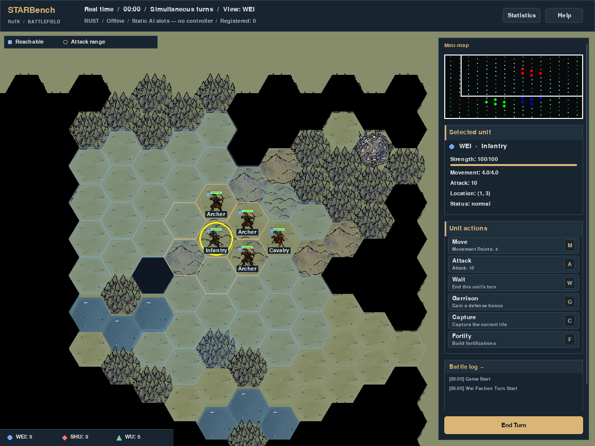
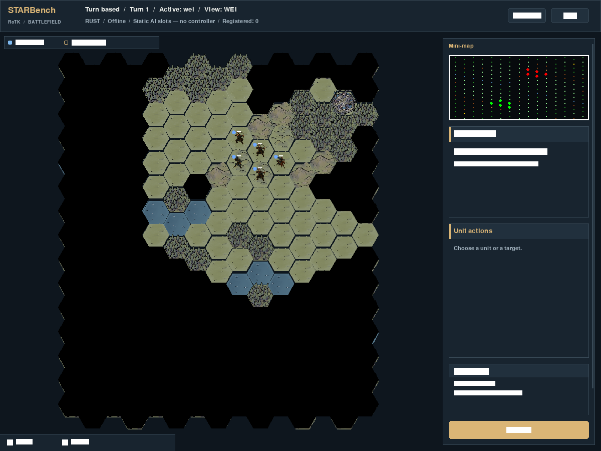
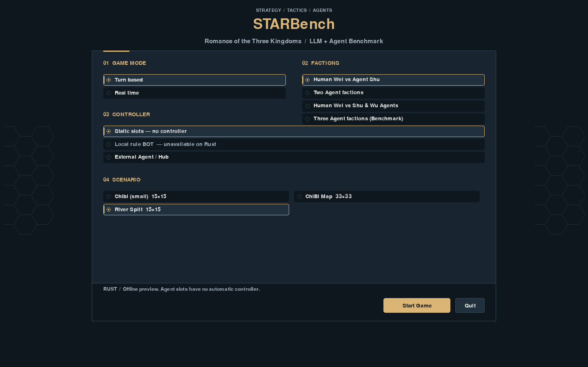
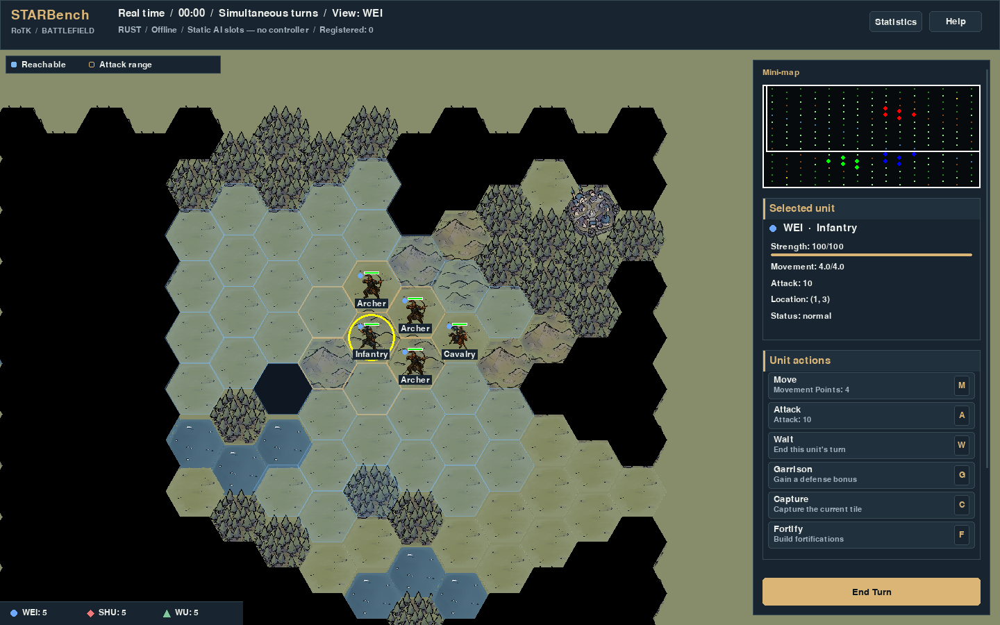

# STARBench window UI

The ordinary Python and Rust pygame window uses visual version `starbench-ui-v6`.
Launch commands and Agent access through star-protocol retain their existing
fields, encoding and permissions. Existing terrain and unit art is retained.

The menu displays STARBench, game mode, factions, controller and scenario. Static
slots have no automatic controller. Rust supports the existing External Agent /
Hub controller; its local rule BOT remains unavailable. Python retains that BOT.
The status bar reports the backend, controller, actual Hub connection and
registered Agent count (registration is not a claim that an Agent is thinking).

The battlefield has a map viewport and a separate right sidebar containing the
mini-map, selection, actions and collapsible battle log. Scroll over the sidebar
to reach its lower content; scroll over the map to zoom at the pointer. Windows
start at 1200×900 when desktop space permits, falling back to 800 high while
retaining the 1200×800 minimum. The opening view fits the actual tile corners
inside the map viewport, with clearance for the legend and roster. It centres
the board's real bounds, including boards that are not centred at (0,0).
Resizing preserves the user's zoom and the world point at the viewport
centre. Labels use high contrast; distant/dense views prioritize selected and
hovered units. Wei uses a blue circle, Shu a red diamond and Wu a green triangle.
Blue translucent hexes indicate reachable cells. Gold outlines show geometric
attack range, not guaranteed permission to attack; enemy markers are outlines.

| Key | Action |
|---|---|
| 1 / 2 | Select a living human infantry / cavalry unit |
| 3 / 4 / 5 | Select distinct living human archers, in entity-ID order |
| M / A | Choose a move / attack target |
| W / G / C / F | Existing Wait / Garrison / Capture / Fortify actions |
| Space / End Turn | Finish the current turn through the same human turn flow |
| Arrows; + / − | Pan; zoom the camera |
| Shift+1 | Existing global Fog toggle |
| Shift+2 / 3 / 4 | Wei / Shu / Wu spectator view |
| Esc | Close a modal, otherwise cancel targeting, then selection |
| F1 / Tab | Help / statistics |

A missing number slot keeps the current selection. Action keys use the existing
panel availability and execution methods. Attack-target mode does not turn an
empty-ground click into movement. HUD backgrounds and modals consume clicks;
right-click on the map clears targeting and selection. F1 and CLI help derive
from the same binding table as input and action-button hints.

A scene-owned `UiContext` supplies layout, theme, input ownership and bounded
pygame caches. It lives outside authority/schema. Tactical surfaces use SRCALPHA
and are bounded to 128 entries and 32 MiB; text to 1024 entries and 8 MiB. Static panels and action rows use a separate
128-entry / 8 MiB cache keyed only by their visual content. Exit
releases these caches. Render commands snapshot nested clipping, keep painter
order and batch only adjacent blits with identical clips. SDL, fonts, painting
and screenshots run on the display thread; Rust's single authority owner and
ordered delta consumer are retained.

VLM capture uses the same complete paint path, including toolbar/action controls,
without admitting input or advancing authority. Its actual picture therefore
changes with this visual version. The pre-existing global screen/view contract,
frame encoding and protocol fields are unchanged. Record the visual version when
comparing image-based benchmark runs. This is not a new per-Agent camera policy.

Finite UI acceptance and raw evidence are recorded in STAR Lab's
`experiments/2026-10-ui-refresh`; render checks are fixed-projection regressions,
not a new throughput or capacity claim.

## v6 toolbar press feedback — 2026-10-11

End Turn now highlights on hover and darkens/depresses its face and label by
2 pixels while pressed. A quick down/up pair retains the pressed appearance
for at least 120 ms from mouse-down, so an entire click between two frames still
has visible feedback. A longer hold recovers on release; dragging out or
disabling/hiding the button cancels the feedback. Help and Statistics share the
same press rendering. Paint and input retain the same outer hit rectangles.

The existing callback runs once on mouse-down. Mouse-up, hover, animation frames
and VLM paint do not invoke it. Timing and pointer tracking live in the toolbar
system outside authority; cached surfaces vary by a boolean pressed state,
without per-frame timestamp keys. Scene exit releases all three mouse listeners.
Runtime identity and profiler metadata read the central v6 visual constant;
screenshot benchmarks must record v6 separately. The v5 terrain correction,
compact startup, game rules and Agent protocol are retained.

346 affected UI/input/native/Hub/protocol/render/cache checks pass, including
15 SDL-queue cases across Python and Rust serial/threaded authority. Animation
expiry preserves the complete authority export. Real Cocoa frames on both
backends show quick-click feedback and recovery; the Rust capture repaint keeps
window RGB pixels at a fixed feedback phase. This checks the repaint path. The
legacy TGA bytes/PNG label remain unchanged; SDL decoding of those bytes differs
from screen RGB, as recorded separately in the validation. No decoder parity or
new capacity claim is made.

Pressed and recovered states from the actual Rust window:


[Window captures and validation](ui-polish-v6/validation.json) record this change.

### End Turn resource/event parity correction — 2026-10-11

The original toolbar callback directly rotated `TurnManager`; Space used
`TurnSystem.end_turn()`. Clicking therefore changed the active faction without
resetting AP/MP, checking victory or publishing the next TurnStartEvent. The
native toolbar inherited this mismatch through its low-level `toolbar_end_turn`
command. Earlier click/animation acceptance checked faction switching but did
not check resource recovery.

Both human inputs now share the existing turn flow: Python calls
`TurnSystem.end_turn()`, while Rust calls `LocalControls.finish_turn()` and
`finish_human_turn()`. Resource resets, status updates, victory checks, statistics
and ordered turn events follow the keyboard behavior. An absent TurnSystem is
a no-op for both inputs. Agent end-turn behavior, protocol and native kernel are
unchanged. This corrects input routing; the rendering style and visual version
remain `starbench-ui-v6`.

The SDL regression spends actual AP through Wait before each input, checks
restoration and movement reset across a complete round, and observes the proper
Python event bus or native ordered scene callback. Manager-order/missing-manager,
game-over, missing-system and stale-scene guards have additional parity coverage.
All 373 affected UI/input/native/Hub/protocol/turn/render/cache checks pass.
Before the fix, all three backend button cases failed to recover AP while all
three Space cases passed; all six now pass. Actual Python and Rust Cocoa windows
also restore AP from 0 to 2 through both inputs, preserve movement reset and
authority across subsequent pure paint, and advance Wei/1 → Shu/1 → Wei/2.
[Validation and Cocoa window evidence](ui-polish-v6/turn-parity-validation.json)
record the result.

## v5 terrain correction — 2026-10-11 (historical)

The user rejected the v4 map texture and heavy black hex seams. V4 applied the
UI's deep-slate colour to terrain's transparent pixels, exposing the seams as
dark grid lines. V5 restores the original grass clear/composition colour
(135, 141, 106), while UI panels keep their independent slate theme. This returns
the continuous ground appearance and preserves the compact startup and one-time
viewport framing. Fog, tile art, tactical outlines, rules and Agent controls are
unchanged.



66 relevant window/framing/terrain/input/native checks passed. Cocoa startup
captures for both backends preserved full authority across paint; Rust VLM
repaint also matched window RGB pixels. Runtime identity and active profiler
record v5. [Actual compact startup](ui-polish-v5/battle.png) and
[validation/source hashes](ui-polish-v5/validation.json) are retained. This is a
colour correction with no new timed capacity measurement. V3/v4 evidence below
is historical; screenshot comparisons must record `starbench-ui-v5` separately.

### Toolbar click correction — 2026-10-11

End Turn, Help and Statistics previously polled `InputState.mouse_pressed`, which
the window input path never updated. They now consume `MouseButtonDownEvent`
using its own position and the current shared paint/hit rectangle. Only left
clicks invoke callbacks; disabled/hidden buttons and modal blocking are retained.
Frame update and pure screenshot paint do not dispatch another click. Scene exit
and native preparation release the toolbar listener. The existing Python/Rust
turn callbacks, game rules and Agent protocol are unchanged.

Nine SDL-queue regression cases cover Python and Rust serial/threaded authority,
one click per turn, stale polled input, Help/Statistics, modal/disabled/hidden
buttons, resize before the next frame, and listener teardown. All 256 affected
UI/input/native/Hub/protocol checks pass. Cocoa window event dispatch on both
backends verifies Wei/1 → Shu/1 → Wei/2 and authority equality across subsequent
pure paint. [Validation and source hashes](ui-polish-v5/end-turn-validation.json)
retain the result. There is no new pixel styling; visual version remains v5.

## v4 window framing — 2026-10-11 (historical)

The user-reported startup filled nearly the desktop: the Cocoa reproduction
opened at 2480×1235, with a 2070-pixel-wide map viewport. The narrow board left
large grass-coloured regions outside its edges. Automatic startup now uses a
compact 1200×900 window; callers can still request larger sizes, and manual
window resizing remains available. The same reproduction's map viewport is now
872 pixels wide.

`UiContext` frames the board once after sidebar layout is established, using
actual hex corners and uniform zoom within the existing 0.15–3.0 window limits.
It keeps 24 pixels at either side, 42 above and 46 below for the legend/roster.
Native renderer handoff, sidebar scrolling and ordinary resize do not repeat
this framing or reset a user's camera. Very large boards can exceed the view at
the minimum zoom, as before. A wide maximized window can retain margins because
board and viewport aspect ratios differ; the map is not stretched or cropped
to remove them.

Frame clearing, compact opaque terrain composition and native VLM paint share
one deep-slate background colour. This changes map-edge and transparent seam
pixels as well as the startup framing. Black Fog hexes remain the original
visibility presentation. The terrain cache remains opaque, compact and reused;
framing does no new steady-frame map scan. Rules, authority/schema, star-protocol,
Agent access, global screen/view policy and historical frame encoding are retained.



[Previous desktop-sized startup](ui-polish-v4/before-battle.png),
[menu](ui-polish-v4/menu.png), [selected unit](ui-polish-v4/selected.png),
[help](ui-polish-v4/help.png) and [exact-size wide view](ui-polish-v4/wide-battle.png).

164 affected window/UI/input/native/Hub/protocol checks passed, 18 focused
terrain/render/picking checks passed, and 94 portable performance contracts
passed. These suites overlap. Both backends preserved full authority across
40 exact-size raster captures in total: menu and initial/selected/help at
1200×800, 1200×900, 1440×900, 1920×1080 and 2480×1263.
Both also passed Cocoa startup paint and the existing interactive smoke:
selection, targeting, Fog, help, wait, sidebar ownership and resize. Rust VLM
paint preserved authority and RGB equality with window paint. Active profiler
metadata and runtime identity record `starbench-ui-v4`.

[Validation, source and image hashes](ui-polish-v4/validation.json) and exact-size,
Cocoa framing and smoke result JSON are retained in `ui-polish-v4/`. Cocoa can
clamp requested window heights; framing records distinguish requested and actual
dimensions. This revision did not rerun a timed capacity experiment. The v3
measurements below remain historical v3 evidence, not v4 performance results.
Screenshot-based comparisons must record v4 separately from v2/v3; the pixel
and default framing changes affect visual observations.

## v3 polish and visual history

The [assessment and plan](ui-polish-plan.md) records the inherited boundaries.
v2 introduced the shared layout, input ownership and bounded painting caches.
v3 refines the slate/gold palette, menu choice states and primary buttons, adds
section header bands and keyboard chips, and shows a strength meter beside the
existing numeric count. A small cached hex motif appears only in the menu.
Map/sprite assets, layout/hit rectangles, action availability and controls are
retained. Existing panel, text and tactical cache limits remain in force.





The screenshot observation contains these new pixels. `VISUAL_VERSION` is the
single source for UiContext, runtime readiness/manifests and profiler metadata.
Compare image-based benchmark runs with this version recorded; v2 and v3 are
different visual conditions. Structured observations, VLM permissions, global
screen/view policy, historical encoding/label, star-protocol and Agent access
are retained. No authority or protocol source files changed in this revision.

## v3 finite verification — 2026-10-11

146 affected UI/input/native session/Hub/protocol checks passed, as did all 94
portable structural performance checks. These suites overlap. Pure paint
preserved full authority for both backends at all four exact sizes: 1200×800,
1440×900, 1920×1080 and 2480×1263. Both backends passed the existing Cocoa window
smoke covering selection, targeting, help, Fog, wait, sidebar input and resizing;
Rust also preserved full authority and RGB pixel equality across VLM/window paint.
The runtime identity and active profiler both record `starbench-ui-v3`.

The same full-paint frozen Rust projection was measured once before and once
after for each size, using the existing Lab probe, 10s warmup and 30s measurement
at 30 FPS. Each run retained 1200 frame samples, including 900 measured samples.
All four used the same native extension SHA256:
`fe758b178041c0b6149fc06be435e93d702933435982cb2c5a96b78f0e94c8f0`.

| Resident units | Draw mean, v2 → v3 | Draw P99, v2 → v3 | Result |
|---|---|---|---|
| 15 | 6.048 → 5.991 ms (−0.94%) | 8.169 → 8.100 ms (−0.84%) | pass |
| 5000 | 5.207 → 5.309 ms (+1.97%) | 8.101 → 7.692 ms (−5.05%) | pass |

The inherited mean ≤1.05× and P99 ≤1.10× draw guards pass. Small-scene maximum
draw time increased from 8.527 to 10.132 ms; raw tails are retained. Platform
presentation is measured separately. This finite UI regression check makes no
active-world, networking, end-to-end latency or capacity claim.

[Validation and source hashes](ui-polish-v3/validation.json), the original
performance result JSON and gzip frame samples under `ui-polish-v3/performance/`,
and Cocoa captures under `ui-polish-v3/smoke/` are saved with this revision.
`source_sha` in the Lab probe is the supplied source label: the candidate was an
uncommitted patch on `65941ef`, identified by the validation file's source hashes.
Before/menu/battle and current menu/battle/help captures are included.

Regenerate exact-size previews using the checkout's own helper, which reads the
current visual version rather than hard-coding a historical version:

```bash
uv run --extra native python tools/capture_ui_previews.py \
  --backend rust --output /tmp/starbench-ui-previews
uv run python tools/capture_ui_previews.py \
  --backend python --output /tmp/starbench-ui-python-previews
```

These are SDL dummy raster captures with authority-equality guards, separate
from the archived Cocoa smoke. The ordinary launcher remains `uv run starbench.py`.
